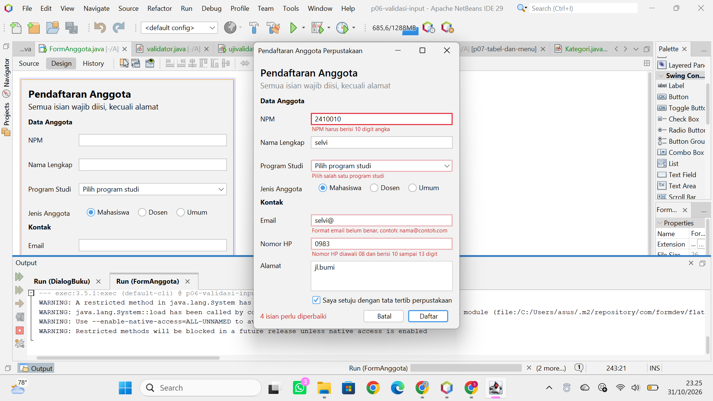
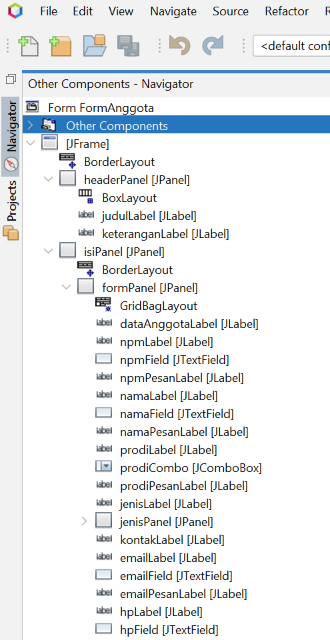
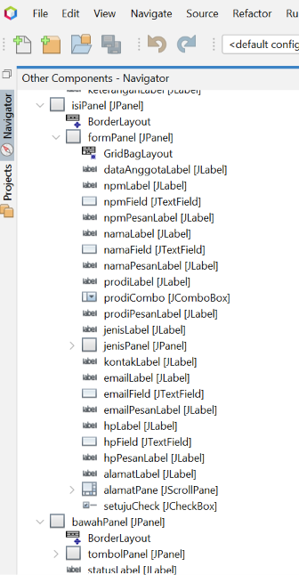

# P06 – Validasi Input dan Kegunaan

## 1. FormAnggotaPerpustakaan

FormAnggotaPerpustakaan merupakan aplikasi yang telah diperbaiki berdasarkan hasil peer review dengan menerapkan validasi input dan peningkatan kegunaan aplikasi.

File yang disertakan:
- FormAnggota.java
- FormAnggota.form
- P06ValidasiInput.java
- validator.java
- ujivalidator.java
- pom.xml

---

## 2. Peer Review

### Tabel Hasil Peer Review

**Nama Peninjau:** Siti Ekarina Septianor
**NPM:** 2410010364

**Nama Pemilik Form:** Selvia Melani Putri
**NPM:** 2410010140

| No. | Heuristik | Temuan | Skor | Saran |
|---|---|---|---|---|
| 1 | Visibilitas status sistem | Status ringkasan tidak berubah ketika isian sudah diperbaiki. Tombol Daftar nonaktif sebelum persetujuan dicentang tanpa penjelasan. | 2 | Perbarui atau kosongkan statusLabel setelah isian diperbaiki. Tambahkan tooltip pada tombol Daftar. |
| 2 | Kesesuaian dengan dunia nyata | Semua jenis anggota wajib mengisi NPM dan Program Studi, padahal Dosen dan Umum umumnya tidak memiliki keduanya. | 2 | Sesuaikan isian berdasarkan jenis anggota atau jelaskan bahwa form ditujukan untuk mahasiswa. |
| 3 | Kendali dan kebebasan pengguna | Tombol Batal memiliki konfirmasi, tetapi tombol X langsung menutup aplikasi tanpa konfirmasi. | 2 | Tambahkan konfirmasi ketika jendela ditutup menggunakan windowClosing. |
| 4 | Konsistensi dan standar | Placeholder hanya tersedia pada NPM, Email, dan HP. Tooltip hanya tersedia pada NPM. | 1 | Tambahkan placeholder pada Nama dan tooltip pada Nama, Email, serta Nomor HP. |
| 5 | Pencegahan kesalahan | Nama masih dapat menerima angka. NPM dan HP dapat menerima huruf melalui Ctrl+V. | 2 | Tolak angka pada Nama dan gunakan DocumentFilter untuk NPM serta HP. |
| 6 | Mengenali, bukan mengingat | Petunjuk format NPM, Email, dan HP tersedia, tetapi aturan Nama dan Nomor HP baru terlihat setelah terjadi kesalahan. | 1 | Tampilkan petunjuk format sejak awal melalui tooltip atau placeholder. |
| 7 | Fleksibilitas dan efisiensi | Enter menjadi tombol default, tetapi tidak berfungsi ketika Daftar nonaktif dan tidak memindahkan fokus ke isian berikutnya. | 1 | Pertimbangkan navigasi fokus menggunakan Enter dan tambahkan petunjuk syarat tombol Daftar. |
| 8 | Desain estetis dan minimalis | Tampilan rapi, tetapi font keterangan berbeda dari komponen lain dan kalimat keterangan belum diakhiri titik. | 1 | Seragamkan font dan rapikan teks keterangan. |
| 9 | Membantu memperbaiki kesalahan | Pesan kesalahan tetap muncul ketika pengguna sedang memperbaiki isian. | 1 | Hapus tanda kesalahan secara langsung menggunakan DocumentListener. |
| 10 | Bantuan dan dokumentasi | Petunjuk hanya berupa keterangan, tooltip pada NPM, dan placeholder. Belum ada petunjuk untuk isian lain maupun tombol pintas. | 1 | Tambahkan tooltip dan petunjuk singkat mengenai tombol pintas Alt. |

[📄 Lihat Dokumen Peer Review](peer%20review.docx)

---

## 3. Tabel Temuan, Perbaikan, dan Commit

Berikut ringkasan temuan berdasarkan hasil peer review beserta perbaikan yang telah dilakukan.

| No. | Temuan | Perbaikan yang Dilakukan | Commit |
|---|---|---|---|
| 1 | Jendela langsung tertutup ketika tombol X diklik tanpa konfirmasi. | Menambahkan WindowListener untuk konfirmasi sebelum aplikasi ditutup. | P06: perbaikan validasi input berdasarkan peer review |
| 2 | Isian Nama masih dapat menerima angka. | Menambahkan keyTyped menggunakan Character.isDigit() dan evt.consume(). | P06: perbaikan validasi input berdasarkan peer review |
| 3 | NPM dan Nomor HP dapat menerima huruf melalui Ctrl+V. | Menambahkan DocumentFilter untuk membatasi input angka dan panjang karakter. | P06: perbaikan validasi input berdasarkan peer review |
| 4 | Pesan kesalahan lama tetap muncul ketika isian diperbaiki. | Menambahkan DocumentListener untuk validasi langsung. | P06: perbaikan validasi input berdasarkan peer review |
| 5 | Jumlah isian yang perlu diperbaiki tidak langsung berubah. | Menambahkan validasiAktif dan perbaruiStatusValidasi(). | P06: perbaikan validasi input berdasarkan peer review |

Dokumentasi tabel lengkap:

[📄 Lihat Tabel Temuan, Perbaikan, dan Commit](Tabel%20Temuan%2CPerbaikan%2CCommit.docx)

---

## 4. Screenshot Form dengan Pesan Kesalahan

Berikut tangkapan layar form yang menampilkan pesan kesalahan ketika pengguna memasukkan data yang tidak sesuai dengan ketentuan validasi.



---

## 5. Screenshot Jendela Navigator

### 5.1 Navigator Label Pesan Atas

Berikut tampilan Navigator yang memperlihatkan komponen label pesan pada bagian atas form.



### 5.2 Navigator Label Pesan Bawah

Berikut tampilan Navigator yang memperlihatkan komponen label pesan pada bagian bawah form.



---

## 6. Jawaban Eksperimen Praktikum 4

### 1. Ketik huruf pada isian NPM. Apa yang terjadi dan baris mana di npmFieldKeyTyped yang menyebabkannya?

Huruf tidak bisa masuk ke NPM karena hanya menerima karakter angka.

Kode yang menyebabkan hal tersebut:

```java
if (!Character.isDigit(evt.getKeyChar()) || penuh) {
    evt.consume();
}
```

Perintah tersebut membatalkan karakter yang tidak memenuhi ketentuan.

### 2. Isi email dengan siti@, lalu tekan Tab. Kapan pesan kesalahan muncul?

Pesan kesalahan muncul setelah tombol Tab ditekan dan fokus berpindah dari isian email ke komponen berikutnya. Hal ini terjadi karena event focusLost menjalankan validasi email ketika isian tidak kosong.

### 3. Klik isian Nama tanpa mengetik, lalu tekan Tab. Mengapa tidak ada pesan kesalahan?

Karena program hanya memeriksa nama apabila isian tidak kosong.

Kode yang digunakan:

```java
if (!namaField.getText().isBlank()) {
    periksaNama();
}
```

Validasi untuk isian kosong baru dilakukan ketika tombol Daftar diklik.

### 4. Centang persetujuan, lalu klik Daftar dengan form kosong. Isian mana yang mendapat fokus?

NPM mendapat fokus karena merupakan isian pertama yang diperiksa dan kosong. Program menyimpan komponen yang salah ke dalam daftar salah.

Kode:

```java
salah.get(0).requestFocusInWindow();
```

Kode tersebut memindahkan fokus ke isian pertama yang mengalami kesalahan.

### 5. Tekan tombol Alt bersama huruf N. Isian mana yang mendapat fokus, dan properti apa yang mengaturnya?

Fokus berpindah ke Nama Lengkap. Hal ini diatur oleh properti displayedMnemonic pada label Nama dan labelFor yang menghubungkan label dengan namaField.

### 6. Isi beberapa isian, lalu klik Batal dan pilih No. Apakah data tetap ada?

Data tetap ada karena pengguna memilih No. Program menjalankan return sehingga proses pengosongan form dibatalkan.

Dokumen jawaban:

[JAWABAN EKSPERIMEN 4 (P06).md](JAWABAN%20EKSPERIMEN%204%20(P06).md)

---

## 7. Deklarasi Penggunaan AI

Dalam pengerjaan tugas ini, saya menggunakan dua alat AI: ChatGPT untuk memeriksa kode program, dan Claude untuk memperbaiki kalimat serta pembuatan isi readme.

---
